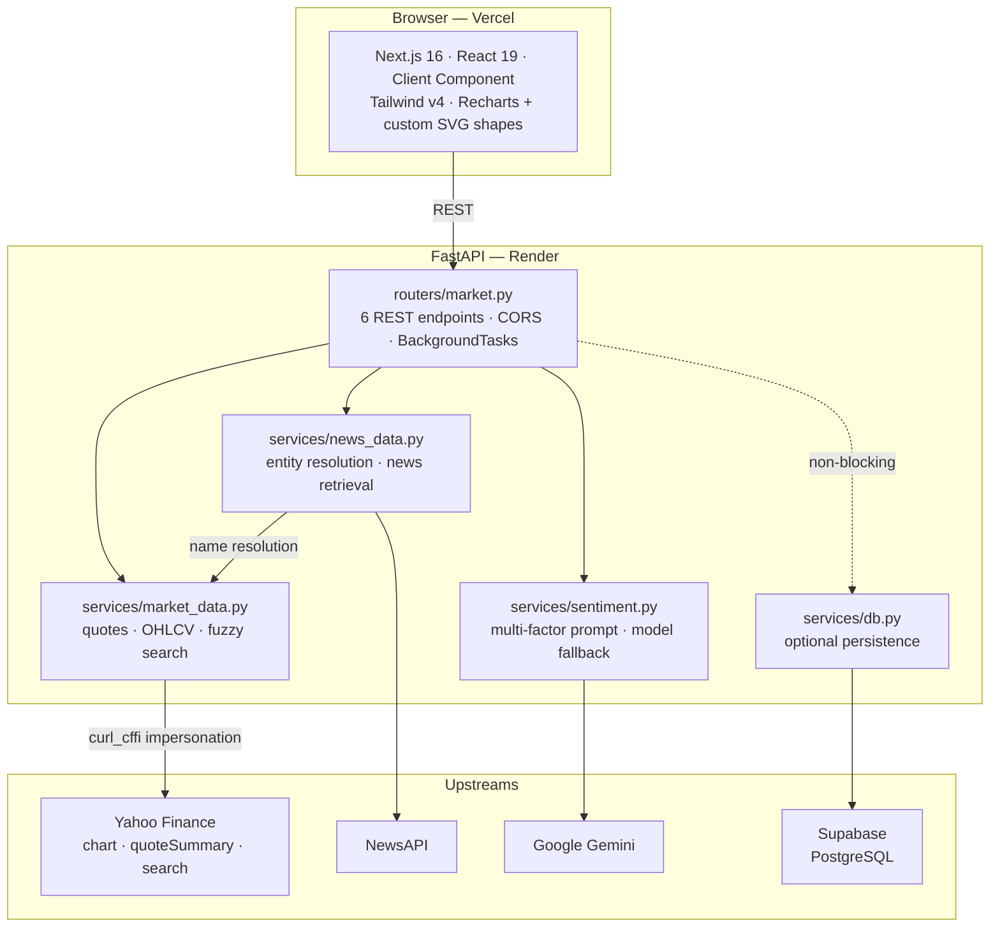

# AI-Powered Quantitative FinTech Dashboard
Live Demo: https://fintech-dashboard-azure.vercel.app

A real-time, multi-factor market analysis terminal that fuses OHLCV market data, global financial news, and an LLM acting as a quantitative analyst into a single sentiment score with a defensible rationale.


---

## Overview

Most retail dashboards show you a price chart and a headline list, then leave the synthesis to you. This terminal does the synthesis.

Search any global listing by name or ticker, and the dashboard assembles three independent views of the asset and reconciles them into one read:

| Factor | Source | What it contributes |
| --- | --- | --- |
| **News sentiment** | NewsAPI, 30-article sample | Aggregate tone of coverage, with off-topic articles discarded |
| **Technical momentum** | Yahoo Finance OHLCV | Position within day and 52-week range, volume conviction vs. average |
| **Fundamental context** | Yahoo Finance quote data | Whether a rich or cheap multiple leaves room for the news to move price |

The LLM is prompted as a hedge-fund quantitative analyst and returns a 0–100 score with a 3–4 sentence rationale that must cite both a specific news driver and a specific market-data observation. Every technical ratio it reasons over is computed in Python before the call, because language models are unreliable at arithmetic and a confidently wrong number is worse than no number.

**Coverage is genuinely global.** US, Hong Kong, Singapore, Tokyo, London, Swiss and crypto listings all resolve, chart, and return relevant news — which required solving several problems that only appear outside the US market (see below).

### Interface

- **Autocomplete search** — debounced fuzzy lookup by company name or ticker, full ARIA combobox with keyboard navigation
- **Four chart renderings** — Area, Line, Candlestick and OHLC bar, the latter two drawn as custom SVG shapes
- **Seven time ranges** — 1D, 1W, 1M, 3M, 1Y, 5Y, MAX, each mapped to an appropriate bar interval
- **Key statistics grid** — market cap, P/E, EPS, day and 52-week ranges, volume vs. average, dividend yield
- **AI sentiment panel** — score gauge, bull/bear label, and the model's reasoning
- **News feed** — recent coverage with the resolved search entity shown, so an empty feed is explainable
- **Recent searches** — persisted quick-links with optimistic updates
- Dark and light themes via `prefers-color-scheme`

---

## Architecture



### Stack

**Frontend** — Next.js 16 (App Router, Turbopack), React 19, TypeScript 5, Tailwind CSS v4 (zero-config), Recharts 3, lucide-react. Deployed on Vercel.

**Backend** — FastAPI 0.143 on Python 3.14, Starlette 1.8, yfinance 1.7, curl_cffi 0.16 (browser TLS impersonation), pandas 3.0, `google-genai` 2.31, NewsAPI. Deployed on Render.

**Data** — Supabase (PostgreSQL) for search telemetry, with a `search_history` table and server-side timestamps.

### API surface

| Method | Endpoint | Purpose |
| --- | --- | --- |
| `GET` | `/` | Liveness probe |
| `GET` | `/api/search?q=&limit=` | Fuzzy ticker/company autocomplete |
| `GET` | `/api/asset/{ticker}?period=` | Quote snapshot + OHLCV history for a range |
| `GET` | `/api/news/{ticker}?limit=` | Recent headlines for the resolved entity |
| `GET` | `/api/analysis/{ticker}` | Multi-factor sentiment over news + market data |
| `GET` | `/api/history?limit=` | Recently searched tickers, de-duplicated |

Interactive OpenAPI docs are served at `/docs`.

---

## Engineering Highlights

These are the problems that took real work. Each was diagnosed by measurement rather than assumption, and most were found only because the system was tested against non-US assets.

### 1. Defeating TLS-fingerprint gating

Yahoo's search endpoint returned `429` to every request from the Python `requests` library — with a browser `User-Agent`, with a warmed cookie jar from `finance.yahoo.com`, with the `fc.yahoo.com` + `getcrumb` handshake, and across both `query1` and `query2` hosts. The block is keyed on **TLS fingerprint**, not headers, so no amount of header spoofing helps.

The fix routes the request through `curl_cffi` with Chrome impersonation, which replays a real browser's TLS handshake and returns `200`. `curl_cffi` already ships as a yfinance dependency, so this added no new package — it is now pinned explicitly since the code imports it directly.

### 2. Surviving datacenter IP bans in production

Yahoo serves fundamentals from `quoteSummary` and charts from `chart`, and **blocks them independently**. On Render's datacenter IPs, `quoteSummary` returns nothing — `ticker.info` is `{}` — while `chart` keeps working. The symptom is a dashboard that draws a perfect chart above a KPI grid of `N/A`.

Injecting an impersonated session does not help here, and the investigation is worth recording: yfinance 1.7 **already** defaults to `curl_cffi` with `impersonate="chrome"`, so an identical session is a no-op on the fingerprint. It is also unsafe, because `YfData` is shared across every `Ticker` instance — passing `session=` on one call replaces the session for all concurrent requests and discards yfinance's cached cookie/crumb.

The working fix reads the metadata block that rides along on the `chart` response we already fetch, and backfills the profile from it at **zero additional network cost**. This recovers **13 of 18 profile fields**: name, exchange, currency, timezone, price, change percent, volume, previous close, day range and 52-week range.

Two correctness guards came out of testing this, both of the "a wrong number is worse than a gap" variety:

- `chartPreviousClose` is the close before the chart **window**, not the prior session. Mapping it unconditionally reported Apple's real 0.50% daily move as **2.97%**. It is now used only on intraday ranges, where the window is today and the value is correct.
- `history[-2]` is only the prior session on **daily** bars. On 5Y (weekly) and MAX (monthly) bars it is last week or last month. The fallback is gated on bar interval, so those ranges return `null` and the UI renders `N/A` rather than a confident 2.98%.

Market cap, P/E, EPS, dividend yield and average volume are served *only* by `quoteSummary` and remain unavailable under a block. Fixing those requires an egress IP the provider accepts — which is why the roadmap leads with a data-layer migration rather than another workaround.

### 3. Custom SVG candlestick and OHLC geometry

Recharts has no candlestick primitive. The naive approach — `<Bar dataKey="close">` with a custom shape — hands the shape a rectangle spanning *close to axis-base*, which carries no high/low information and forces the shape to reverse-engineer the pixel scale from the axis.

Instead the bar is fed an **array** `dataKey` of `[low, high]`. Recharts maps an array value to `y = scale(high)` and `height = scale(low) − scale(high)`, so the rectangle it provides already spans exactly the wick. Every other price is then a linear interpolation inside that box:

```
toY(price) = y + (high − price) / (high − low) × height
```

The shape never touches the axis scale, the plot offset, or the axis base, so it cannot drift out of sync with the axis — it derives everything from the box the axis itself produced. Candle bodies are floored at 1px so a doji stays visible, and a zero range degenerates to a single line instead of dividing by zero.

Verified by cross-checking the box-relative interpolation against an independent axis-scale computation over 87 real bars, including 13 dojis and one flat bar: **maximum deviation 5.7 × 10⁻¹⁴ pixels, zero invariant violations.**

### 4. Exchange-local time on intraday axes

History timestamps are emitted as full ISO-8601 with the **exchange's** UTC offset, and the profile carries the exchange's IANA timezone. Every axis and tooltip formatter passes that zone explicitly.

This is a correctness issue, not a polish one. Formatted in the viewer's local zone, a Hong Kong trading session reads 21:30–04:00 for a user in New York. Formatted in market time, it reads 09:30–16:00 as it should. Axis tick granularity follows the range (`09:30` → `09/15` → `Oct 2025`) while tooltip granularity follows the actual bar interval, so a monthly bar never implies single-session precision.

### 5. Global entity resolution for news

NewsAPI indexes prose, so a ticker symbol matches nothing. Querying `D05.SI` returned literally **zero** articles — indistinguishable, in the old API shape, from a company with no coverage.

The resolver looks the symbol up through Yahoo to get a company name, then strips corporate suffixes with six regexes applied **to a fixed point**, because real names stack several layers (`DBS Group Holdings Ltd` needs three passes to reach `DBS`). They cover legal-entity words, dotted abbreviations (`Nestle S.A.`), share classes (`Alphabet Inc Class A`), London-style share descriptors (`BARCLAYS PLC ORD 25P` → `BARCLAYS`), registered-share markers (`NESTLE N` → `NESTLE`), and leftover punctuation.

Two details make it safe. The left anchor is a separator rather than `\b`, so a company whose entire name *is* a suffix word survives — `DBS Group` strips, bare `Group` does not. And `dr` was deliberately excluded from the share-descriptor list, because it would reduce `Keurig Dr Pepper` to `Keurig`. Twenty cases are asserted, including the must-not-strip guards.

Measured impact on article counts:

| Ticker | Query by symbol | Query by resolved name |
| --- | --- | --- |
| `D05.SI` | **0** | `"DBS"` → 409 |
| `BARC.L` | **0** | `"BARCLAYS"` → 1,152 |
| `NESN.SW` | **0** | `"NESTLE"` → 217 |
| `0700.HK` | 1 | `"TENCENT"` → 346 |
| `7203.T` | 2 | `"TOYOTA MOTOR"` → 55 |

Relevance needed a second pass. Searching full article bodies surfaced a Barclays story that merely mentioned DBS, and the model scored it as DBS sentiment. Restricting to `searchIn=title,description`, quoting every phrase, and excluding package registries (PyPI release notes are not market signal) brought precision to 4–5 relevant of 5.

### 6. Fault-tolerant AI pipeline

The sentiment service walks a model chain — `gemini-3-flash-preview`, falling back to `gemini-flash-lite-latest` — advancing on `404` or `429` so a retired or quota-capped model degrades to a working one, while credential errors stop the walk immediately. The available models were established by live probing, not by `list_models()`, which advertises models that 404 on `generateContent`.

Two schemas are maintained **deliberately**. The model is asked for a minimal `{"sentiment_score", "reasoning"}` shape it complies with reliably; the frontend consumes `{status, sentiment, score, reasoning}`. A normalization layer adapts between them, so prompt changes can never break the client contract. Nothing from the model is trusted: scores are coerced and clamped to 0–100, empty reasoning gets a placeholder, and the bull/bear **label is derived from the score** rather than requested — the previous version asked for both independently and a model could return "bullish" with a score of 35.

Entity disambiguation is handled in the prompt, and it works. Live runs report discarding "PostgreSQL databases, Aston Martin cars" for DBS, "Apple and Linux" for Tencent, and "apple cider vinegar, movies, and podcasts" for Apple.

### 7. Verifying financial data units instead of assuming them

Two fields would have shipped as 100× errors if taken at face value:

- `regularMarketChangePercent` is **already a percent**. Apple at 342.96 against a 341.27 previous close is +0.495%, and the API returns `0.49521` — not a fraction needing `×100`.
- `dividendYield` is **also already a percent**. Apple returns `0.32`, corroborated by `trailingAnnualDividendYield` of `0.00308` (= 0.31%). Treating it as a fraction would have advertised Apple at a **32% dividend yield**.

Both were confirmed by cross-referencing a second field and recomputing from raw prices before a line of formatting code was written.

### 8. Zero-latency optimistic UI

Recent-search chips are written to Supabase by a `BackgroundTasks` job that runs *after* the response is flushed, so the database never sits on the dashboard's critical path. That creates a race: the frontend refetches history as soon as an asset loads, often before the insert commits.

A naive optimistic update would make this worse, because the history effect replaced state with the server list — the chip would appear and then vanish. The fix is a small state reconciler used for both directions:

```ts
mergeRecent([justSelected], current)   // optimistic prepend
mergeRecent(current, fromServer)       // reconcile without losing it
```

`primary` wins on both position and presence, so local entries survive a server list that does not yet contain them. De-duplication is by ticker, a repeat keeps its newer position, and a `company_name` is backfilled from the server when the local entry lacked one but never overwritten by a `null`.

Verified by extracting the shipped function straight out of the source and running it under Node's type stripping — 13 assertions covering the prepend, the cap, the race, and the cold-start path.

### 9. Graceful degradation as a design rule

Every upstream can fail independently, and each failure mode is **distinguishable from an empty result** — the recurring bug this codebase is built to avoid is a dashboard that cannot explain itself.

- `news_status` separates "no recent coverage" from "the news feed is down"
- `profile_status` separates "scored without fundamentals" from a neutral read
- `persistence` separates "nobody has searched yet" from "the database is unconfigured"
- `news_count` vs `news_analyzed` makes clear the score came from 30 articles while the UI shows 5
- Supabase has four independent disable paths (package missing, variables unset, variables still template placeholders, malformed credentials) and `log_search` is total — it cannot propagate an exception into a background task
- A quote-endpoint failure still renders a chart; a chart failure still renders KPIs

### 10. React 19 compiler compliance

The React compiler lint rejects synchronous `setState` in an effect body. Rather than suppress it, loading flags became **derived state**: each fetched slice is stored tagged with the key it was requested for, and `isLoadingAsset` is simply `asset?.key !== assetKey`.

That removed the flags *and* eliminated stale-response bugs for free — a reply for a previous ticker no longer matches the current key, so it can never render. Combined with `AbortController` cleanup, a slow `"ap"` autocomplete response cannot land after a fast `"apple"` one.

---

## Local Setup

### Prerequisites

- Python 3.11+ (developed on 3.14)
- Node.js 18+ (developed on 26)
- API keys for NewsAPI and Google Gemini; a Supabase project is optional

### Install

```bash
git clone https://github.com/<vastotu>/fintech-dashboard.git
cd fintech-dashboard

# Backend
cd backend
python3 -m venv .venv
.venv/bin/pip install -r requirements.txt
cp .env.example .env          # then fill in your keys

# Frontend
cd ../frontend
npm install
cp .env.example .env.local
```

### Run

```bash
./start_dev.sh
```

Starts FastAPI on `:8000` and Next.js on `:3000`, and tears both down on `Ctrl+C`. Note that the script fails fast by design — if one server dies, it stops the other, so a crashed backend never looks healthy.

- Dashboard → http://localhost:3000
- API docs → http://localhost:8000/docs

### Environment variables

**`backend/.env`**

| Variable | Required | Notes |
| --- | --- | --- |
| `NEWSAPI_KEY` | Yes | News retrieval; without it the feed reports an explicit outage |
| `GEMINI_API_KEY` | Yes | Sentiment engine; without it the panel reports "model unavailable" |
| `SUPABASE_URL` | No | Search telemetry. Omit and persistence silently disables |
| `SUPABASE_KEY` | No | Anon key |
| `FRONTEND_URL` | No | CORS allow-list, comma-separated. Unset allows any origin |

**`frontend/.env.local`**

| Variable | Required | Notes |
| --- | --- | --- |
| `NEXT_PUBLIC_API_URL` | Yes in production | Backend base URL, no trailing slash. Defaults to `http://localhost:8000` |

> `NEXT_PUBLIC_*` values are inlined into the browser bundle at **build** time. Changing this on a hosting platform requires a redeploy, not a restart.

### Supabase schema

Optional. Without it, recent-search chips simply never appear.

```sql
create table if not exists search_history (
    id           bigint generated always as identity primary key,
    ticker       text not null,
    company_name text,
    created_at   timestamptz not null default now()
);
create index if not exists search_history_ticker_idx on search_history (ticker);
create index if not exists search_history_created_at_idx on search_history (created_at desc);
```

`created_at` is defaulted in the database deliberately: server time is the one clock every writer agrees on, so rows stay orderable regardless of application-server timezone or drift.

### Verification scripts

```bash
cd backend
.venv/bin/python verify_market_data.py     # live quotes, all 7 ranges, OHLC, error paths
.venv/bin/python -m services.news_data     # entity resolution across global tickers
.venv/bin/python -m services.sentiment     # full multi-factor prompt + model response
.venv/bin/python -m services.db            # persistence state and degradation paths

cd ../frontend
npx tsc --noEmit && npx eslint app/ && npm run build
```

---

## Known Limitations and Trade-offs

Stated plainly, because each one drives a roadmap item.

- **Fundamentals are IP-dependent.** Market cap, P/E, EPS, dividend yield and average volume come only from Yahoo's `quoteSummary`, which datacenter IPs lose. The chart-metadata fallback covers 13 of 18 fields; these five need a real data provider.
- **No caching.** Every request hits the upstreams live, so the Gemini free tier's rate limit is reachable under light use — the primary model already falls back to Flash-Lite regularly. This is the highest-value fix available.
- **The API is unauthenticated.** With `FRONTEND_URL` unset, CORS allows any origin, and there is no rate limiting. Acceptable for a demo; it exposes the NewsAPI and Gemini quotas to anyone who finds the URL.
- **Optimistic chips are not rolled back.** A chip appears whether or not the write succeeds, and a failed write clears only on reload. Rolling back would require putting the database back on the response path, undoing the reason for `BackgroundTasks`.
- **News is English-only.** English-language wires do cover global listings, and the sentiment model reads English, but local-language coverage is missed.
- **Short, common company names stay noisy.** `"DBS"` still matches a PostgreSQL article where "DBs" means databases. A finance-keyword filter was deliberately *not* added, because combined with title-only matching it would discard legitimate business stories and trade away the global recall the resolver just won.

---

## Roadmap

### Data layer — eliminate IP restrictions
Migrate from `yfinance` to an institutional API such as **Alpaca** or **Polygon.io**. This removes the scraping workarounds entirely, restores the five missing valuation fields on any host, and brings proper SLAs and corporate-action handling. The service boundary is already clean: `market_data.py` is the only module that touches a market-data provider, and the profile shape is built in one place.

### Caching — cut cost and rate-limit pressure
Introduce **Redis / Upstash** in front of news and AI responses. Sentiment is deterministic at `temperature=0` for a given headline set, so it caches well; a short TTL on news and a longer one on resolved company names would cut Gemini and NewsAPI calls substantially and largely remove the `429` fallbacks. Company-name resolution is currently an in-process `lru_cache` that dies with the worker — a shared cache fixes that across instances.

### Identity — personalized watchlists
Add **Clerk** or **Supabase Auth** and key `search_history` to a user ID. The persistence layer is already abstracted behind `services/db.py` with a nullable client, so this is additive rather than a rewrite, and it turns the recent-searches row into real multi-ticker watchlists with alerting.

### Realtime — push instead of poll
Replace REST polling with **WebSockets** for live tick-by-tick updates. The chart already renders from a normalized OHLCV series with a stable contract, so a streaming source can append bars without touching the rendering layer. Candlestick and OHLC shapes derive geometry from each bar's own box, so they update correctly under streaming data with no changes.

### Further hardening
- Automated test suite in CI; verification is currently script-driven and manual
- Structured observability — request tracing and upstream latency, replacing log inspection
- Narrow CORS to named origins and add rate limiting before any public exposure
- Server-side rendering of the initial asset to remove the post-hydration fetch
- Candlestick volume sub-chart and drawing tools

---

## Project Structure

```
fintech-dashboard/
├── backend/
│   ├── main.py                     # FastAPI app, CORS, startup diagnostics
│   ├── requirements.txt
│   ├── routers/
│   │   └── market.py               # 6 REST endpoints, BackgroundTasks wiring
│   ├── services/
│   │   ├── market_data.py          # quotes, OHLCV, search, exchange normalization
│   │   ├── news_data.py            # entity resolution, suffix stripping, retrieval
│   │   ├── sentiment.py            # multi-factor prompt, model chain, normalization
│   │   └── db.py                   # optional Supabase persistence
│   └── verify_market_data.py       # live smoke check
├── frontend/
│   ├── app/
│   │   ├── page.tsx                # dashboard: search, charts, KPIs, sentiment, news
│   │   ├── layout.tsx
│   │   └── globals.css             # Tailwind v4 entry + chart theme variables
│   └── package.json
└── start_dev.sh                    # runs both servers, fails fast
```

---

## License

Unlicensed portfolio project. Market data, news and model output are provided for demonstration only and are **not investment advice**.
